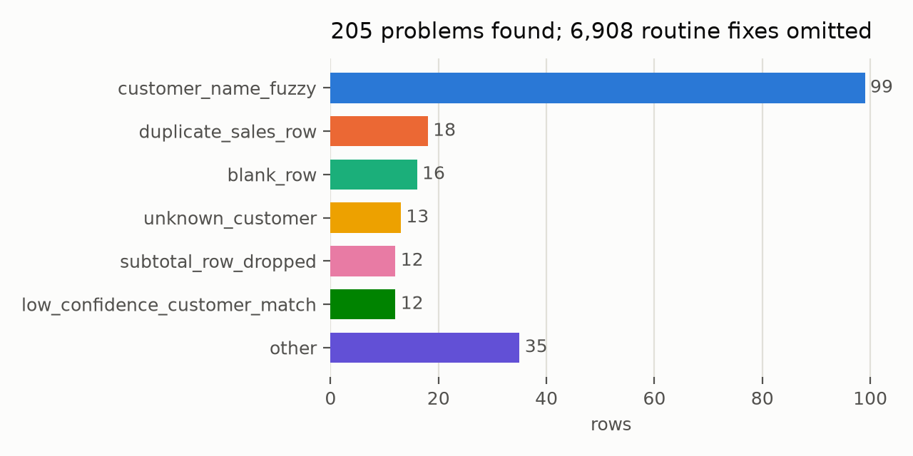
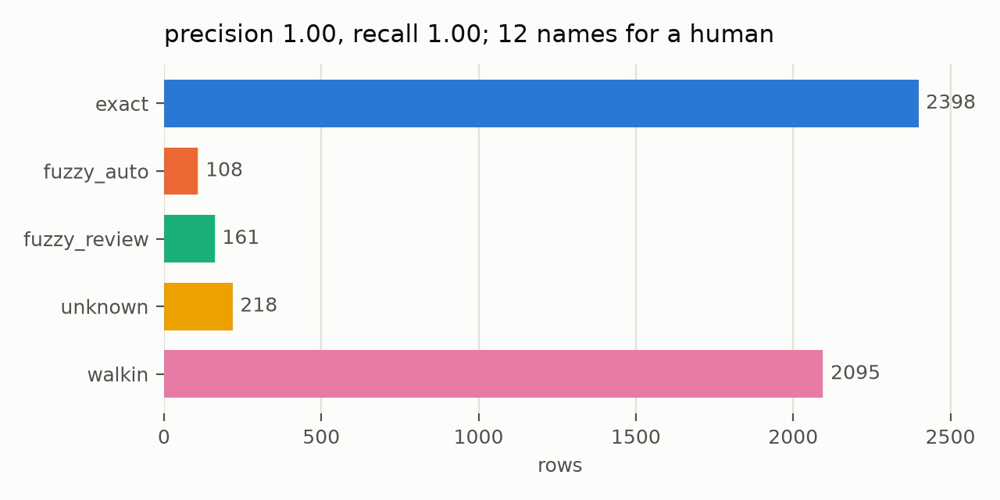
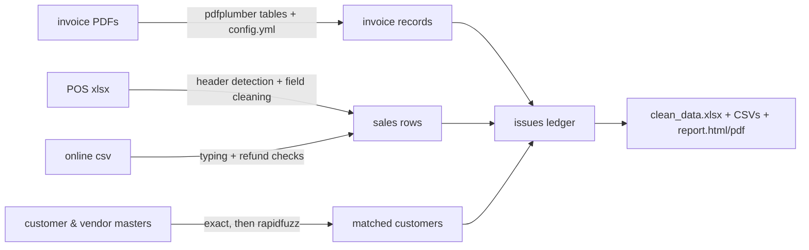

# PDF + Excel cleanup pipeline

`python` `pandas` `pdfplumber` `openpyxl` `rapidfuzz` `reportlab` `pyyaml` `pytest`

A wholesale distributor gets supplier invoices as PDFs in five different
layouts, plus messy sales exports from two systems. This tool turns one
month of files into a single clean Excel workbook, and an audit log of
every change. All data in this repo is **simulated**: the company
("Harbor & Pine Supply"), vendors, customers and products are fictional,
generated by `demo/make_demo_data.py` with a fixed seed.

## Results

Numbers below are written by the pipeline itself into `results/` after
each run (`results_table.csv`, `summary.json`, `run_meta.json`).

| Metric | Value |
|---|---|
| Files in | 127 |
| Invoice PDFs | 125 |
| Invoices parsed | 120 |
| Invoices dropped or blocked | 5 |
| Sales rows in | 5,019 |
| Sales rows out | 4,980 |
| Sales rows dropped (all logged) | 39 |
| Sales rows held for review | 34 |
| Sales total (all rows) | 3,052,452.83 |
| Sales held for review | 19,120.07 |
| Sales total (excluding held) | 3,033,332.76 |
| Audit log entries | 7,113 |
| – routine standardisations | 6,908 |
| – problems needing judgement | 205 |
| Items needing a human look | 76 |
| Demo run time | 2.36 s |

**Routine vs problems.** Most log rows are pure reformatting a bookkeeper
would never read twice (dates, number strings, region spellings, name
casing). The 205 *problems* include every planted defect — the non-name
kinds are all found:

| Planted defect | Found |
|---|---|
| duplicate_invoice | 2/2 |
| scanned_pdf | 3/3 |
| invoice_total_mismatch | 1/1 |
| vendor_tax_id_mismatch | 1/1 |
| future_invoice_date | 1/1 |
| duplicate_sales_row | 18/18 |
| subtotal_row_dropped | 12/12 |
| metadata_row_dropped | 2/2 |
| blank_row | 16/16 |
| unparseable_amount | 6/6 |
| negative_quantity | 8/8 |
| refund_without_sale | 8/8 |
| refund_sign_invalid | 2/2 |
| refund_line_mismatch | 1/1 |

plus 124 customer-name problems (99 fuzzy typos auto-resolved, 8 ambiguous
names held for a human, 17 unknown customers flagged — see the next table).

## Customer matching — measured, not assumed

The demo generator writes `input/matching_truth.csv`: for every messy
customer name it plants, which master customer it came from — or that it
is genuinely unknown or deliberately ambiguous (e.g. "Riverbend Bo"
between *Riverbend Books* and *Riverbend Boutique*). The pipeline scores
itself against that truth in `results/matching_eval.csv` / `.json`:

| Metric | Value |
|---|---|
| Names evaluated | 512 |
| Auto-applied, correct | 486 |
| Auto-applied, wrong | 0 |
| Sent to Review | 12 |
| Unknowns flagged | 17 |
| Precision | 1.0 |
| Recall | 1.0 |

Names are normalised (case, spacing, punctuation, Inc/LLC/Ltd suffixes),
matched exactly, then by Levenshtein similarity. A fuzzy match is applied
only when it scores >= 66 **and** beats the runner-up by >= 12 — so
ordinary typos resolve automatically while names with two plausible
masters go to the `Review` sheet. Configurable in `config.yml`.

## What the inputs look like


The invoice PDFs are drawn with reportlab — bordered line-item tables,
header boxes, a logo and a different layout per vendor. The extractor
reads them through `config.yml`: `strategy: table` uses pdfplumber's
ruled-table extraction for the line items, with per-vendor field regexes
for headers and a text-mode fallback.

<picture>
  <source media="(prefers-color-scheme: dark)" srcset="docs/images/problems_by_type_dark.png">
  
</picture>

<picture>
  <source media="(prefers-color-scheme: dark)" srcset="docs/images/match_methods_dark.png">
  
</picture>

## How it works



- **Vendor layouts live in `config.yml`**, not in code. A new vendor is a
  new YAML block: an anchor string, header regexes, and a table strategy.
- **Every change is auditable.** Each fix, drop or flag is one row in the
  `Issues` sheet with source file, row/page, old and new value, rule and
  severity (`fixed` / `needs review` / `blocked`). Row counts reconcile:
  rows in = rows out + rows dropped, enforced in code and tests.
- **Held rows are visible, not hidden.** Kept sales rows that need
  judgement (duplicate-looking POS lines, odd refunds, unknown statuses)
  carry a `review_flag` on the Sales sheet; the Summary sheet shows sales
  totals both all-rows and excluding those held rows.
- **Incremental runs:** a manifest of SHA-256 file hashes skips unchanged
  files on re-runs; `--rebuild` redoes everything. The CSV/JSON
  deliverables are byte-identical either way (tested); the workbook and
  `run_meta.json` carry timestamps and are compared by content.

## Adapting it to your files

```yaml
vendors:
  ACME:
    name: "ACME Parts Ltd"
    detect: "ACME Parts Ltd"           # anchor text on the invoice
    number_format: us                  # or "eu" for 1.234,56
    fields:
      invoice_number: 'Invoice #:\s*(ACME-\d+)'
      invoice_date: 'Date:\s*(\d{2}/\d{2}/\d{4})'
      tax_id: 'Tax ID:\s*([0-9-]+)'
      total: 'TOTAL:\s*\$?([\d,]+\.\d{2})'
    date_formats: ["%m/%d/%Y"]
    lines:
      strategy: table                  # pdfplumber ruled-table extraction
      header: 'Item\s+Qty\s+Price\s+Amount'   # also used by the text fallback
      row: '^(?P<desc>.+)\s+(?P<qty>\d+)\s+(?P<unit>[\d,]+\.\d{2})\s+(?P<amount>[\d,]+\.\d{2})\s*$'
      columns: [desc, qty, unit, amount]
      end: 'TOTAL'
```

A client would send: the month's invoice PDFs, the two sales exports, and
clean customer/vendor master files. Then `python -m cleanup run <folder>`.

## Reproduce

```bash
python3.11 -m venv .venv && source .venv/bin/activate   # Windows: .venv\Scripts\activate
pip install -r requirements.txt
python -m cleanup demo          # builds inputs, runs, prints the summary
# or on your own folder:
python -m cleanup run path/to/inputs --out output [--rebuild]
```

Outputs land in `output/`: `clean_data.xlsx` (Summary, Invoices,
Invoice_Lines, Sales, Customers_Matched, Review, Issues — frozen headers,
filters, real `SUM`/`COUNTA` formulas), the same tables as CSV,
`run_log.json`, `report.html` and `report.pdf`.

## Tests

```bash
pytest tests        # 83 tests, no network needed
```

The suite regenerates the demo inputs in a temp dir and verifies: every
planted defect is found by ID, the matcher scores precision 1.0 and
recall >= 0.95 against the planted truth, row accounting holds, each
vendor layout parses, EU numbers and credit notes are signed right,
scanned PDFs are listed, incremental and `--rebuild` runs give
byte-identical outputs, and the workbook opens with the expected sheets
and formulas.

## Repository layout

```
cleanup/            the package: pdf_extract, sales, matching, issues,
                    manifest, pipeline, outputs, cli
config.yml          vendor layouts, match thresholds, aliases
demo/               make_demo_data.py (all inputs, fixed seed), expected.json
docs/               images, decisions.md, walkthrough.md, client_one_pager.md
input/              generated demo inputs incl. matching_truth.csv
results/            numbers the pipeline wrote (README cites these)
tests/              pytest suite
```

## Limitations

- No OCR: scanned PDFs are detected and listed for manual entry, not read.
- Each vendor layout must be described once in `config.yml`; a new or
  changed layout needs a new YAML block before it parses.
- Fuzzy matching is a heuristic — close calls go to Review rather than
  being guessed, by design.
- Only US (`1,234.56`) and European (`1.234,56`) number formats are
  supported out of the box.
- Duplicate detection relies on vendor + invoice number; it will not catch
  the same invoice re-keyed by the supplier under a new number.
